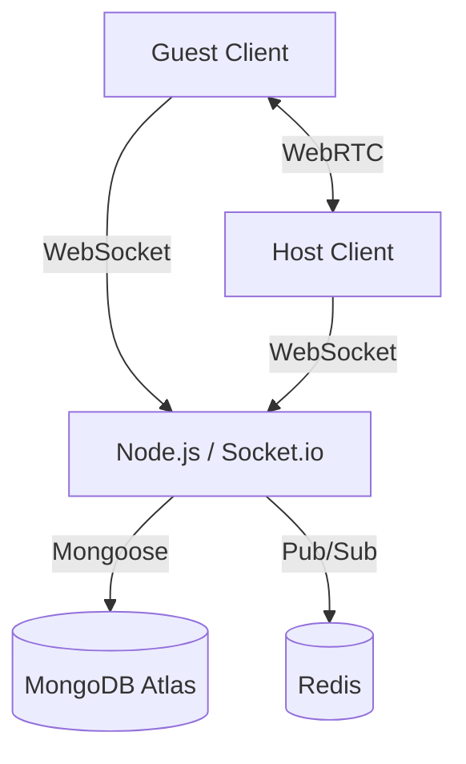

# Architecture

## Component Diagram

## Design Decisions
- **Next.js & React Three Fiber**: Chosen for rapid UI development and high-performance WebGL rendering.
- **Socket.io + Redis**: Standardizes WebSocket communication and provides easy horizontal scaling via Redis Pub/Sub adapter.
- **WebRTC Mesh**: A peer-to-peer mesh network is used to minimize server bandwidth for video/audio.
- **MongoDB**: Used for flexible document storage of Room metadata and host tokens.
